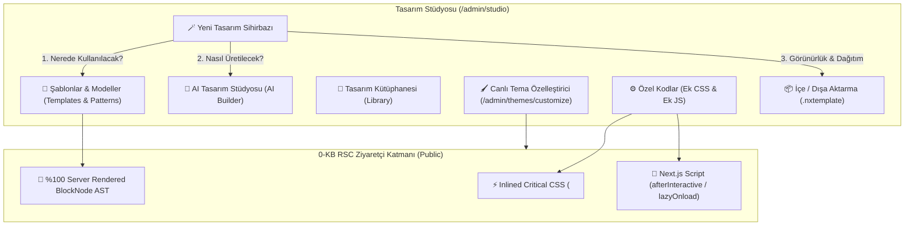

# 22 — NexPress CMS Tasarım Stüdyosu (Design Studio) & Şablon Fabrikası Planı

> **Amaç:** Tema görünüm altındaki şablonlar, senkronize modeller (patterns), tasarım kütüphanesi ve AI tasarım asistanını tek bir stüdyo çatısı (`/admin/studio`) altında toplamak; nerede kullanılacağını önceden belirleyerek şablon üretimi yaptırmak; içe/dışa aktarma (`.nxtemplate`), pazar yeri hazır veri yapısı, canlı tema özelleştirici ve 100/100 Lighthouse hızını koruyan güvenli **Ek CSS & Ek JS (Özel Kod)** motorunu kurmak.

---

## 🏛️ 1. Mimari Katmanlar ve Çatı Yapısı

---

## 🧩 2. Modül Detayları ve Yol Haritası

### Adım 1: Tasarım Stüdyosu Eklentisi (`@nexpress/plugin-design-studio`) & Menü
- **Eklenti Manifesti (`apps/cms/src/plugins/design-studio.ts`):**
  - Eklenti adı: *Tasarım Stüdyosu & Şablon Fabrikası* (`@nexpress/plugin-design-studio`)
  - Modüller: `hub`, `templates`, `patterns`, `ai_builder`, `customizer`, `custom_code`, `export_import`
  - `apps/cms/src/plugins/register.ts` içine bağlanır.
- **Yönetim Paneli Sol Menüsü (`admin-nav.ts`, `@nexpress/i18n`):**
  - "Görünüm & Tasarım" grubu altına **Tasarım Stüdyosu** (`/admin/studio`, simge `Palette`, kısayol `G S`) eklenir.

### Adım 2: Tasarım Stüdyosu Ana Arayüzü (`/admin/studio`)
- **Sekmeli Yönetim:**
  1. **Şablonlar & Modeller (Templates & Patterns):** Header, Footer, Sidebar, Blog Detay, Ürün, Kampanya, Sayfa, Kategori, 404, vb.
  2. **AI Tasarım Stüdyosu:** Prompt, sektör ve amaç girerek doğrudan AST blokları üretimi (`@nexpress-pro/ai-design`).
  3. **Tasarım Kütüphanesi:** Kaydedilmiş blok paketleri ve hazır bölümler.
  4. **Özel Kodlar:** Ek CSS ve Ek JS (Head/Body Scriptleri).
  5. **İçe / Dışa Aktar:** `.nxtemplate` JSON/Zip paket yükleme ve dışa aktarma.
- **Yeni Tasarım Sihirbazı:**
  - Kullanım yeri seçimi: Chrome (Header/Footer/Sidebar), İçerik Şablonu, Senkronize Model, Tam Sayfa.
  - Üretim yöntemi: AI, Görsel Editör, İçe Aktar.
  - Görünürlük: Özel (Private), Paylaşılabilir (Public), Pazaryeri Adayı.

### Adım 3: Güvenli Ek CSS & Ek JS (Özel Kod) Sistemi
- **Veri Modeli (`packages/core/src/site-settings.ts`):**
  - `customCss: string`
  - `headerScripts: string`
  - `footerScripts: string`
- **Ön Yüz Enjeksiyonu (`apps/cms/src/app/(public)/[locale]/layout.tsx`):**
  - `customCss`: Sunucuda sanitize edilir ve doğrudan `<style id="nx-custom-css">` olarak gömülür (0 ek HTTP isteği, 0 FOUC).
  - `headerScripts` / `footerScripts`: Güvenli meta/takip kodları `lazyOnload`/`afterInteractive` stratejisiyle sayfa hızını 100/100 tutacak şekilde basılır.

### Adım 4: Tema Özelleştiriciye Ek Kod Sekmesi (`/admin/themes`)
- Tema Özelleştiricide Paletler, Tipografi ve Geometri'nin yanına **"Özel Kodlar" (Ek CSS & Ek JS)** sekmesi eklenir. Canlı önizleme tuvalinde CSS değişiklikleri anında test edilebilir.

### Adım 5: `.nxtemplate` Standart JSON/Zip İçe/Dışa Aktarma & Pazaryeri Hazırlığı
- Şablon AST blokları, kullanım koşulları (`conditions`), özel CSS ve manifest verilerini içeren saf JSON formatı.
- Kod çalıştırmadığı için sıfır güvenlik riski. İleride NexPress Marketplace üzerinden satılabilir ve güncellenebilir.

---

## 🛡️ 3. Performans ve Güvenlik Güvencesi
- **0-KB RSC Kuralı:** Ziyaretçi tarafında React client bileşeni olmadan 100/100 performans.
- **Sanitize Edilmiş CSS:** `@import "http..."`, `javascript:` ve zararlı fonksiyonlar sunucuda temizlenir.
- **Audit Logging:** Kod ekleme/güncelleme işlemleri `requireAdmin("studio.saveCustomCode")` ve denetim günlüğü (`recordAudit`) ile korunur.
