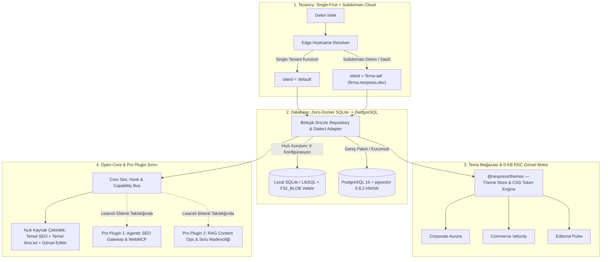

# NexPress CMS: Mimari Şartname ve Ürün Stratejisi (v3.5)

> **Durum:** `\\wsl.localhost\Ubuntu\home\dijitalevre\PROJELER\nexpresscms` dizininde proje iskeleti, `AGENTS.md` kuralları, `@docs` dokümantasyon merkezi ve Docker üzerinde **PostgreSQL 16 (`pgvector 0.8.2`) + Redis 7** veritabanı altyapısı ayağa kaldırıldı.

---

## 1. Dört Stratejik Mimari Sütun + Tema Mağazası (Theme Store)

---

## 2. Tema Motoru ve Tema Mağazası (`@nexpress/themes` & `themes/*`)

WordPress'te tema değiştirmek genellikle sayfa tasarımlarını ve kısa kodları (shortcodes) bozar. NexPress'te **İçerik Verisi ile Görsel Tema birbirinden tamamen ayrılmıştır:**

1. **`theme.json` Manifesto & Tema Mağazası (`/admin/themes`):**
   - Kullanıcılar Admin panelindeki **Tema Mağazası** ekranından `corporate`, `ecommerce` veya `news` profillerine uygun temaları canlı önizleyip tek tıkla etkinleştirebilir.
2. **Tasarım Tokenları (`Design Tokens -> CSS Variables`):**
   - Her tema kendi renk paletini (Açık/Koyu), font ikilisini (`Heading` / `Body`), köşe yuvarlaklığını (`radius`) ve konteyner genişliklerini tanımlar; kullanıcı bunları **Canlı Tema Özelleştirici** ile kod yazmadan değiştirebilir.
3. **Blok Görünüm Varyantları (`Block Skinning`) & Varsayılan Layout'lar:**
   - İçerik blokları (`Hero`, `ProductGrid`, `Pricing`, `FAQ`, `TL;DR`) aynı JSON şemasını korur; aktif tema değiştiğinde blokların React Server Component (RSC) sunumu anında yeni temanın tasarım diline bürünür.
   - Her tema kendi varsayılan **3 Katmanlı Header, Footer ve Mega-Menü** şablonuyla gelir ve Görsel Navigasyon Stüdyosunda özgürce düzenlenebilir.

---

## 3. Kurumsal `shadcn/ui` Admin Paneli & Çift Modlu Editör

* **Kurumsal Tasarım Dili:** `shadcn/ui` (New York stili), Tailwind CSS v4, `Cmd+K` / `Ctrl+K` Global Komut Paleti, Koyu/Açık mod ve Bölünmüş Ekran (Sol: Çalışma Alanı, Sağ: Canlı SEO & AI Çekmecesi).
* **Çift Modlu 0-KB RSC Editör:**
  1. **Doküman Modu (Notion Akıcılığı):** `/` (Slash) menüsü, Answer-First (`TL;DR`) kutusu, adım adım prosedür ve canlı ürün kartı gömme.
  2. **Görsel Kanvas Modu (Framer / Bricks Esnekliği):** 12 sütunlu CSS Grid, responsive kırılımlar ve hazır kurumsal bölüm kütüphanesi.
  3. **3 Katmanlı Header, Footer & Görsel Mega-Menü Stüdyosu:** İçine ürün kartı, kampanya afişi ve ikonlu grid bırakılabilen sürükle-bırak navigasyon oluşturucu.

---

## 4. Kurulan WSL Çalışma Alanı ve Canlı Altyapı Özeti

| Bileşen | Durum / Konum |
| :--- | :--- |
| **Çalışma Alanı (Workspace)** | `\\wsl.localhost\Ubuntu\home\dijitalevre\PROJELER\nexpresscms` |
| **Zorunlu Kurallar** | `AGENTS.md`, `GEMINI.md` ve `.agents/rules/nexpress-rules.md` |
| **Modüler Dokümantasyon** | `docs/01-ARCHITECTURE.md` ... `docs/06-PROGRESS-LOG.md` |
| **PostgreSQL 16 + `pgvector 0.8.2`** | 🟢 Çalışıyor (`nexpress_postgres` — Port: `5434`) |
| **Redis 7 (`BullMQ`)** | 🟢 Çalışıyor (`nexpress_redis` — Port: `6381`) |
| **LibSQL / SQLite Desteği** | 🟢 Hazır (`DB_DIALECT="sqlite"` ile Docker'sız mod) |
